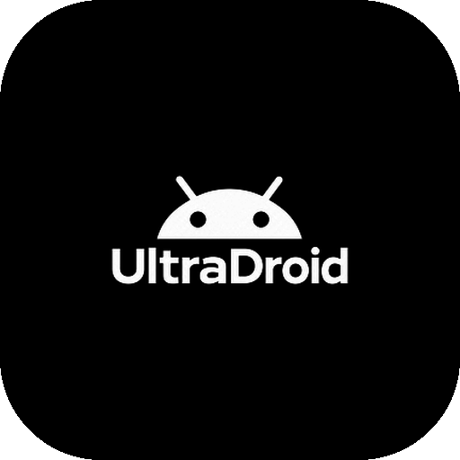

<p align="center"></p>

# UltraDroid — Android (WebView + Shizuku)

UltraDroid arayüzünü (`app/src/main/assets/index.html`) tam ekran bir Android WebView'de çalıştıran, üstüne
**gerçek Android uygulamalarını Win7 pencerelerinde açma** (Shizuku) ekleyen Java/Gradle projesi.

| | |
|---|---|
| `applicationId` | `com.ultradroid.app` |
| Sürüm | **1.9.66** (versionCode 84) |
| minSdk / targetSdk | 24 / 34 |
| Dil / yapı | Java, Gradle 8.4 (AGP 8.1.4), JDK 17 |
| Bağımlılıklar | Shizuku API + provider 13.1.5, androidx.core 1.12.0 (FileProvider) |


> **Win7 teması — Dosya Yöneticisi:** Başlat menüsünde kendi ikonuyla “Dosya Yöneticisi” bulunur (sağ tık → Görev çubuğuna sabitle / Masaüstüne ekle). Aero çerçeveli Win7 Gezgini görünümündedir; telefonun gerçek dosyalarına bağlıdır (İndirilenler, Resimler, Videolar…), zip içine girilir/ayıklanır/sıkıştırılır. HTML dosyası çift tıkla Chrome'da, sağ tıkla Nova veya Internet Explorer'da açılır; zip içindeki HTML önce zip'in yanına ayıklanıp sonra açılır.

---

## Launcher (ana ekran) modu

UltraDroid artık Android'in **ana ekran uygulaması** olarak seçilebilir.

- **Nasıl açılır:** Windows 11 Ayarlar > Sistem > *Varsayılan Başlatıcı* > **UltraDroid’u ana ekran yap**
  (Android 10+ bir onay penceresi açar; olmazsa sistemin "Ana ekran uygulaması" ayarı açılır). Durum yazısı o an
  UltraDroid'un ana ekran olup olmadığını gösterir; düğme "Ana ekranı değiştir"e döner.
- **Eski ana ekrana dönmek:** aynı düğme ya da Android Ayarlar > Uygulamalar > Varsayılan uygulamalar > Ana ekran uygulaması.
- **Sistem tuşları:** hiçbir tuş engellenmez. Ana Sayfa ve Son Uygulamalar sistem tarafından normal işlenir; Geri tuşu ana
  ekranda uygulamayı kapatmaz (normal bir launcher gibi). Sistem çubukları tam ekran kalır, kenardan kaydırınca geçici görünür
  (jest navigasyonu normal çalışır). Ses tuşları yine Win11 ses göstergesini açar.
- **Teknik:** `AndroidManifest.xml` içinde `MAIN + HOME + DEFAULT` intent filtresi; `MainActivity` `singleTask` olduğu için
  Ana Sayfa'ya basınca çalışan örnek öne gelir (`onNewIntent`). Köprü: `AndroidBridge.isDefaultHome()` ve `requestDefaultHome()`.

---

## Kamera uygulaması

Başlat menüsündeki **Kamera** cihazın gerçek kamerasını açar (ön/arka kamera düğmesi, fotoğraf çekme).
İlk açılışta Android "Kamera izni" penceresi çıkar. Çekilen fotoğraf **Kaydet** ile `Resimler/UltraDroid` klasörüne yazılır.
İzin reddedilirse pencerede nedeni ve Android Ayarlar yolu yazar. Başka bir sitenin (ör. yüklü web uygulaması) kamera isteği ayrıca onay sorar.
Teknik: `CAMERA` izni, `WebChromeClient.onPermissionRequest`, `AndroidBridge.savePhoto`.

---

## Canlı duvar kağıdı (video)

Hem **Windows 11 Ayarlar > Kişiselleştirme > Arka plan** hem de **Windows 7 Kişiselleştir > Masaüstü arka planı** ekranında,
galerinden seçtiğin bir videoyu masaüstü duvar kağıdı olarak sessiz ve döngülü oynatabilirsin.

- **Win11:** "Canlı duvar kağıdı" satırındaki **Video seç** düğmesi (seçince hemen uygulanır). **Kaldır** videoyu siler.
  Video seçilince "Canlı: ad" kutucuğu listeye eklenir; başka bir arka plan seçersen canlı duvar kağıdı kapanır, kutucuğa tekrar basınca geri açılır.
  "Resim uyumu" ayarı videoya da uygulanır (Doldur/Sığdır/Uzat/Ortala).
- **Win7:** "Canlı duvar kağıdı (video)..." düğmesiyle video seç, **Değişiklikleri kaydet** ile onayla (İptal edersen eski duvar kağıdı döner).
- Video uygulama verisinde (IndexedDB) saklanır, uygulama yeniden açılınca otomatik devam eder. Uygulama arka plana geçince video durur.
- Teknik: `index.html` içindeki `w7-livewp-js` betiği (`window.__lwp`); video öğesi `.desktop-background.is-main` ile masaüstü simgeleri arasına konur.

---

## 1. APK'yı derleme

**GitHub Actions (bilgisayara bir şey kurmadan)**
1. Klasörün tamamını (ya da zip'i) yeni/mevcut bir GitHub deposuna yükle.
2. **Actions** sekmesinde "Build APK" her push'ta otomatik çalışır; **Run workflow** ile elle de tetiklenir.
3. İş bitince run sayfasının altındaki **Artifacts** bölümünden `UltraDroid-debug-apk` indir, içindeki `app-debug.apk`'yı kur
   (bilinmeyen kaynaklara izin gerekebilir).

İş akışı repo içindeki zip'leri otomatik açar ve `settings.gradle`'ı bulduğu klasörü derler.

**Yerelde:** Android Studio / AndroidIDE'de klasörü aç, Gradle senkronize olsun, Build > Build APK(s).

---

## 2. Proje yapısı

```
Win7Simu-Android/
├─ .github/workflows/build-apk.yml      GitHub Actions derleme akışı
├─ docs/                                README görseli: icon.png (APK'ya girmez)
├─ app/src/main/
│  ├─ assets/index.html                 UltraDroid arayüzü (tek dosya, ~4,8 MB)
│  ├─ java/com/ultradroid/app/
│  │  ├─ MainActivity.java              WebView, AndroidBridge (JS köprüsü), yerel tarayıcı WebView'leri
│  │  ├─ FileOps.java                   Dosya Gezgini'nin gerçek telefon dosyaları katmanı (liste, ad değiştir, sil, kopyala, aç)
│  │  └─ VdService.java                 Shizuku UserService: sanal ekran, dokunma/fare/tuş enjeksiyonu
│  ├─ aidl/.../IVdService.aidl          MainActivity <-> VdService arayüzü
│  └─ AndroidManifest.xml
└─ README.md
```

---

## 3. Kalıcı depolama

`AndroidBridge.sGetAll / sPut / sDel / sClear` sayfanın localStorage'ını gerçek SharedPreferences'a yazar. Uygulamayı
kapatıp açsan da duvar kağıdı, kısayollar, tema, ayarlar kaybolmaz.
`AndroidBridge.fetchSiteInfo` ise "uygulama olarak kaydet" diyaloğunun site başlığı/simgesini çekmesi için basit bir
HTTP isteği yapar.

---

## 4. Temalar ve görünüm

Kişiselleştir penceresinden seçilir; aynı anda yalnızca biri açık kalır.

- **Windows 7** (varsayılan): Aero cam şeffaflığı, bulanıklık, gölge, aktif/pasif pencere renkleri.
- **Windows 11**: yalnızca pencereler, ikonlar, başlık menüsü, görev çubuğu ikonları ve görev çubuğu ortalaması değişir.
  Görev çubuğunun sağı Win11 gibidir: `^` · ENG · ağ · ses · pil · saat (12 saat, AM/PM, A/G/YYYY) · bildirim ayı.
  Başlat menüsü, arama, hızlı ayarlar ve sağ tık menüsü de Win11 stilindedir
  (`w11-theme-*`, `w11-start-*`, `w11-search-*`, `w11-tray-*`, `w11-qs-*`, `w11-tb-*`, `w11-ctx-css`).
- **Windows 11 saydamlık ve bulanıklık:** Ayarlar > Kişiselleştirme > *Saydamlık ve bulanıklık* (eski "Temalar" satırının yerine geldi,
  Win7 Kişiselleştir penceresini açmaz). Bulanıklık miktarı (0–60 px) ve saydamlık (%0–80) ayarlanır; pencereler, görev çubuğu,
  Başlat, hızlı ayarlar, saat/takvim/ses/bildirim panelleri ve sağ tık menüleri için ayrı ayrı açılıp kapanır. Ayarlar
  `localStorage['w11fx']` içinde tutulur. Kod: `<style id="w11fx-css">` ve `<script id="w11fx-js">` (`html.fx-*` sınıfları + `--fx-a` / `--fx-b`).
- **Windows 11 Ayarlar > Kişiselleştirme** (hepsi Win11 Ayarlar içinde çalışır, eski Win7 Kişiselleştir penceresi açılmaz):
  *Arka plan* (hazır resimler, Windows 11 varsayılanı, galeriden fotoğraf, resim uyumu), *Renkler* (vurgu rengi paleti/özel renk,
  yüzeylerde ve pencere kenarında vurgu), *Başlat* (Önerilen bölümü aç/kapa, simge boyutu, sabitlenen uygulamaları gizle/sırala),
  *Görev çubuğu* (orta/sol hiza, arama kutusu/simge/gizle, simge boyutu, Başlat düğmesi simgesi + özel görsel).
  Ayarlar `localStorage['w11pers']` ve `['w11pins']` içindedir. Kod: `w11pers-css` / `w11pers-js`; `window.__w7pz` Win7 kişiselleştir köprüsüdür.
- Windows 10 teması **kaldırıldı** (v1.8.4).
- **Ubuntu (GNOME / Yaru)** (v1.9.65): Kişiselleştir penceresinde ya da Win11 Ayarlar > Kişiselleştirme > Temalar'da **Ubuntu** seçilir.
  Win11 katmanının üstünde çalışır (`#root` üzerinde `ubuntu` sınıfı); Windows görev çubuğu gizlenir, yerine:
  - **Üst panel:** solda *Etkinlikler* düğmesi, ortada saat (`Kas 23  23:42`), sağda ağ · ses · pil simgeleri.
  - **Sol dock:** favoriler + açık uygulamalar (turuncu nokta = çalışıyor), altta *Uygulamaları göster* (9 nokta).
    Uzun bas / sağ tık: Aç · Favorilere ekle/kaldır · Kapat. Favoriler `localStorage['ub_dock']`.
  - **Uygulama menüsü:** koyu yarı saydam ızgara, üstte turuncu çerçeveli arama kutusu; Başlat menüsündeki tüm programlar.
  - **Pencereler:** libadwaita başlık çubuğu (ortalanmış kalın başlık, 24 px yuvarlak küçült/büyüt/kapat düğmeleri), 12 px köşe, GNOME gölgesi.
    Büyütülen pencere panel ile dock arasındaki alanı doldurur; ekrana sığmayan pencere ilk açılışta sığdırılır.
  - **Hızlı ayarlar (sağ üst):** pil, Ekran görüntüsü / Ayarlar / Kilitle / Güç (Yeniden başlat · Kapat · Windows'a dön),
    ses ve parlaklık kaydırıcıları, Wi-Fi · Bluetooth · Güç Modu · Gece Işığı · Koyu Stil · Rahatsız Etme · Uçak Modu.
    Wi-Fi/Bluetooth/Uçak/Gece ışığı/Güç modu Win11 hızlı ayarlarıyla ortak durumdadır (`window.__w11qs`).
  - **Saat menüsü (ortada):** solda bildirimler (sistem bildirimleri `__w7toast` buraya düşer, GNOME balonu olarak görünür) ve
    *Rahatsız Etme* anahtarı; sağda gün/tarih, Pazartesi ile başlayan ay takvimi (önceki/sonraki ay), Etkinlikler, Dünya Saatleri, Hava Durumu kartları.
  - Varsayılan **Koyu Stil** açıktır (Win11 uygulamalarının içi koyu olduğu için); hızlı ayarlardan kapatınca açık Yaru görünümüne geçer (`ub_dark`).
  - Ubuntu seçilince Ubuntu duvar kağıdı uygulanır; başka arka plan seçilince o kullanılır.
  - Kod: `<style id="ub-theme-css">` ve `<script id="ub-theme-js">` (`window.__ubTheme.set(true|false)`).
- **Arch Linux (KDE Plasma 6 / Breeze Koyu)** (v1.9.66): Kişiselleştir penceresinde ya da Win11 Ayarlar > Kişiselleştirme > Temalar'da **Arch Linux** seçilir.
  Ubuntu temasıyla aynı anda açık olmaz; Windows görev çubuğu gizlenir, yerine:
  - **Alt panel:** solda Arch logolu *Uygulama Başlatıcı*, sabitlenen + açık uygulamalar (altta mavi çizgi = etkin, gri = açık),
    sağda tepsi: bildirimler · ağ · ses · pil · saat (`00:30` / `24.11.2026`) · *Masaüstüne göz at*. Uzun bas / sağ tık: Aç · Sabitle/Ayır · Kapat (`ar_fav`).
  - **Kickoff başlatıcı:** kullanıcı + arama; solda Favoriler / Tüm Uygulamalar / Son Kullanılanlar / Ev; altta Sistem Ayarları, Kilitle,
    Oturumu kapat (Windows'a dön), Yeniden başlat, Kapat.
  - **Pencereler:** Breeze başlık çubuğu (30 px, ortalı başlık, solda uygulama simgesi), ⌄ ⌃ ✕ düğmeleri, kapatmada kırmızı daire.
  - **Tepsi menüleri:** Bildirimler (+ Rahatsız Etme), Ağlar (Wi-Fi / Bluetooth / Uçak kipi), Ses düzeyi, Güç ve Pil (parlaklık, güç tasarrufu, gece ışığı), takvim.
  - Kod: `<style id="ar-theme-css">` ve `<script id="ar-theme-js">` (`window.__archTheme.set(true|false)`).
- **Konsole** (v1.9.66, her temada, Başlat menüsünde Komut İstemi'nin yanında): KDE terminal penceresi (menü çubuğu, sekme, `arch@archlinux:~$` istemi).
  Şimdilik boş: yazı yazılır ve Enter yeni satıra geçer ama komut çalıştırılmaz. Kod: `<script id="ar-konsole-js">`.

**Chrome penceresi (Chrome 2019 stili):** gri sekme şeridi, yuvarlak köşeli aktif sekme, hap biçimli adres çubuğu
(Google "G" + yıldız), geri/ileri/yenile, üç nokta menü, profil simgesi, ince küçült/büyüt/kapat düğmeleri.
Kod: `<style id="cx-chrome-skin">` ve `<script id="cx-chrome-skin-js">`. Ana sayfa düğmesi gizlidir
(geri açmak için CSS'te `[data-test-home-button]` satırını sil).

---

## 5. Tarayıcı pencereleri: yerel Android WebView

Chrome, Internet Explorer ve Nova Browser pencerelerindeki http/https içerikleri sistemin Android WebView'i ile açılır.
HTML'deki köprü (`create / navigate / setRect2 / destroy / snap / goBack / goForward / reload / navState`)
`MainActivity.java` içinde uygulanmıştır.

- WebView pencere gövdesinin üstüne konur, pencerenin dışına ve görev çubuğunun altına taşmaz.
- Sürükleme/boyutlandırma sırasında HTML `snap()` ile aldığı JPEG'i pencereye koyar ve WebView'i gizler; durunca WebView geri gelir.
- Geri/ileri/yenile düğmeleri görünen WebView'in kendi geçmişini kullanır; geri gidilecek yer yoksa Chrome ve Nova kendi geçmişlerine döner.
- Web sitelerine `addJavascriptInterface` eklenmez; siteler `AndroidBridge`'e erişemez.
- WebView sürümü cihazdaki "Android System WebView" paketidir (Play Store'dan güncellenir).

**Nova Browser (v1.6)**
- **Masaüstü sitesi:** Menüden ya da Ayarlar > Web > "Desktop site" ile açılınca tüm yerel WebView sekmeleri masaüstü
  User-Agent'ına (Linux / Chrome) geçer, viewport 1280 px'e sabitlenir ve sayfa yenilenir. Yeni sekmeler de aynı moda uyar.
- **Sayfayı kaydet:** Menüdeki "Save page" sitenin o anki DOM'unu (script'ler çıkarılmış, `<base>` eklenmiş) tek bir `.html`
  olarak **Downloads** klasörüne yazar. Android 10+ için izin gerekmez (MediaStore); Android 9 ve altı için
  `WRITE_EXTERNAL_STORAGE` istenir.

---

## 6. Android uygulamaları Win7 penceresinde (Shizuku)

Başlat menüsünden bir Android uygulamasına tıklayınca:
1. Shizuku kuruluysa ve çalışıyorsa, izin yoksa "İzin verilsin mi?" sorulur.
2. İzin varsa Shizuku UserService (shell yetkisi) ile trusted virtual display açılır (`VdService.java`).
3. Uygulama o ekranda `am start --display` ile başlatılır.
4. Sanal ekran, Win7 penceresinin gövdesine oturtulmuş bir SurfaceView'e çizilir; dokunma ve fare olayları sanal ekrana enjekte edilir.

Shizuku yoksa/çalışmıyorsa/izin verilmezse uygulama normal ekranda açılır.

**Pencereler:** Birden çok Android uygulaması aynı anda ayrı pencerelerde açılabilir. Her pencerede Geri (◀), Küçült,
Büyüt/Önceki boyut ve Kapat vardır; başlığa çift dokunmak büyütür. Küçültülen pencere görev çubuğuna iner. Kapat (✕)
uygulamayı tamamen sonlandırır (force-stop). Uygulama tam ekranda (immersive) çalışır; sistem alt çubuğu gizlenir.

**Fare ve eksen:** Hover, sol/sağ tuş ve tekerlek gerçek fare olayı olarak iletilir. Oyunda kamera ekseni ters ise başlık
simgesine dokununca / başlığa sağ tıklayınca açılan sistem menüsünden yön (A/0°/90°/180°/270°) ve x⇄y seçilir;
seçimler uygulama başına hatırlanır.

**Görünüm:** Pencereler UltraDroid'in gerçek bileşenleriyle çizilir (`window__wrapper > window__main`, `window__titlebar`,
`window__control-item`, `window__body`, kenar tutamaçları, `maximized` sınıfı). Mesaj kutuları da aynı sınıflarla çizilir.

**Özel simge:** Android uygulamasına (başlat menüsü / masaüstü kısayolu / görev çubuğu) sağ tıkla ya da uzun bas →
"Simgeyi değiştir…". "Simgeyi sıfırla" uygulamanın kendi simgesine döner.

**Hibrit canlı kare modu:** Normalde uygulama SurfaceView ile ~60 FPS gösterilir. Pencere sürüklenirken/boyutlandırılırken
sanal ekran geçici olarak bir `ImageReader`'a bağlanır; kareler JPEG olarak `https://w7vdframe.local/f?id=N` adresinden
(shouldInterceptRequest) sunulur ve pencere içindeki `` ile çizilir. Bırakınca SurfaceView'e dönülür.
Kare akışı en çok ~30 kare/sn, uzun kenar en çok 960 px, JPEG kalitesi 62.

**Native sanal fare imleci (v1.8.9):** Sanal fare (touchpad) açıkken imleç HTML'de değil, `root`'un en üstüne eklenen saydam bir
SurfaceView'de (`CursorView`) çizilir; index.html, Android uygulama pencereleri ve tarayıcı WebView'lerinin hepsinin üstünde kalır.
Köprü: `vcShow / vcBitmap / vcPos / vcRoute`. `vcRoute` imlecin altındaki native pencereyi bulur (`vcHit`) ve ona gerçek fare olayı
(`SOURCE_MOUSE`: hover, bas/bırak, sürükle, tekerlek) gönderir; hedef HTML ise `w7vm-js` eskisi gibi sahte olay yollar.
Sanal fare açıkken gerçek dokunmalar yalnızca ana WebView'e gider. Android pencereleri artık JPEG'e düşmeden SurfaceView'de kalır.
Yeni pencere açılınca imleç yüzeyi yeniden oluşturulup en üste alınır (`vcTop`).

**Özel imleç görseli (v1.9.0):** Win11 Ayarlar > Bluetooth ve cihazlar > Fare sayfasında (ve Denetim Masası > Fare > Sanal Fare sekmesinde) "Görsel seç…" ile bir PNG seçilir; en uzun kenarı 128 px'e küçültülür (şeffaflık korunur, oran korunur) ve ayarlara kaydedilir. "Sıfırla" ya da bir imleç şeması seçmek özel görseli kaldırır. "Tıklama noktası": İmlecin ortası / Sol üst köşe (varsayılan) / Sağ üst köşe. İmleç boyutu ayarı görselin uzun kenarına uygulanır. Dosya seçici gerçek dokunuş ister; sanal fare açıkken sahte tıklamayla açılmayabilir, görseli sanal fare kapalıyken seç.

**Gerçek fare (OTG / Bluetooth, v1.9.6):** Fare takılınca (`InputManager` cihaz dinleyicisi, sanal olmayan `SOURCE_MOUSE` cihazı) sanal fare **otomatik açılır**:
sistemin kendi imleci gizlenir (pointer capture, Android 8+), fareyi sanal (native) imleç kullanır. Hareket, sol/sağ tuş ve tekerlek göreli olarak `physCaptured` ile alınır,
kare başına bir kez `window.__w7vmPhysEv(dx,dy,tuşlar,yatay,dikey)` ile HTML'e iletilir; HTML bunu mevcut sanal fare hattına (`hover / vcRoute / wheel`) verir, yani Android pencereleri ve tarayıcı WebView'leri de fareyle çalışır.
Fare modundayken parmakla dokunma normal (doğrudan) çalışır, touchpad gibi davranmaz. Fare çıkarılınca sanal fare eski durumuna döner. Ayar: Win11 Ayarlar > Fare > "Fare takılınca otomatik aç" (Win7 Denetim Masası > Fare > Sanal Fare > Gerçek fare);
imleç hızı ayarı fareye de uygulanır. Sanal fareyi elle kapatırsan o fare takılı kaldığı sürece otomatik mod duraksar. Köprü: `vcPhys(bool)`, `vcPhysPresent()`.

**Sınırlar:** Android 10+ gerekir
(trusted display için 13+), `FLAG_SECURE` uygulamalar siyah görünür, pencere sürüklenirken katman geçici gizlenir.

---

## 6b. Dosya Gezgini (Windows 11 teması) — gerçek telefon dosyaları

Win11 temasındaki **Dosya Gezgini** artık telefonun gerçek depolamasını (`/storage/emulated/0`) gösterir; örnek/sahte ağaç yalnızca
uygulama dışında (masaüstü tarayıcıda, köprü yokken) kullanılır.

| Gezgin'deki ad | Telefondaki klasör |
|---|---|
| İndirilenler | `Download` |
| Belgeler | `Documents` |
| Resimler | `Pictures` |
| Müzik | `Music` |
| Videolar | `Movies` |
| DCIM, Projeler, Android | aynı adla (Projeler yoksa oluşturulur) |

- **İzin:** İlk açılışta "Tüm dosyalara erişim" (Android 11+) ya da depolama izni (Android 10 ve altı) istenir; verilince liste kendiliğinden yenilenir.
- **İşlemler:** yeni klasör / metin belgesi, yeniden adlandır, kes-kopyala-yapıştır, sil (hepsi gerçek dosyalar üzerinde), çift tıkla/dokun ile aç.
  Dosyalar ilgili Android uygulamasında açılır; APK'ya dokununca kurulum ekranı gelir (bilinmeyen kaynaklara izin gerekebilir).
- **Giriş sayfası:** "Son kullanılanlar" telefondaki en son değişen dosyalardır (Android klasörü hariç).
- **Köprü:** `AndroidBridge.fsAccess / fsRequestAccess / fsEnsure / fsList / fsMkdir / fsNewFile / fsRename / fsOpen / fsDelete / fsPaste / fsRecent / fsSpace`.
  Yollar kök hariç `/` ile verilir; `..` ve kök dışına çıkış reddedilir. Gizli (`.` ile başlayan) dosyalar listelenmez.
- **Sınır:** Android 11+ `Android/data` ve `Android/obb` klasörlerini sistem uygulamalara kapatır; bu klasörler "okunamadı" der.

**ZIP desteği (v1.9.4)**
- **İçine girme:** `.zip` dosyasına çift dokununca zip, klasör gibi açılır; içindeki klasörlere girilir, adres çubuğunda zip adı görünür. Zip içindeki bir fotoğraf/video/müziğe
  çift dokunmak Media Player'da açar (dosya `cache/zipview` altına çıkarılır; önbellek 400 MB'ı aşınca temizlenir). Diğer dosyalar ilgili uygulamada açılır.
- **Ayıklama:** zipe sağ tık → **Buraya ayıkla** (bulunduğun klasöre) ya da **“ad” klasörüne ayıkla** (zip adıyla yeni klasör). Command bar'daki ⋯ menüsünde **Ayıkla** da vardır.
  Zip içindeyken boş alana sağ tık → **Tümünü ayıkla**. Zip içinden **Kopyala** + başka klasörde **Yapıştır** seçili öğeleri tek tek ayıklar.
  Aynı adlı dosya varsa üzerine yazılmaz, `ad (2).uzantı` olur. `../` ile kök dışına yazmaya çalışan zip girdileri atlanır (zip slip).
- **Sıkıştırma:** bir ya da birden çok dosya/klasör seç → sağ tık ya da ⋯ menüsü → **Zip’e sıkıştır** → ad sor → bulunduğun klasöre `.zip` yazar.
- **Zip içinde değişiklik yok:** Zip içine dosya eklenemez; kes, sil, yeniden adlandır, yeni klasör, yapıştır kapalıdır.
- **Köprü:** `AndroidBridge.fsZipExtract(zip, hedefKlasor, yeniKlasorAc, cb)` ve `fsZipCreate(ustKlasor, adlarJson, zipAdi, cb)` (arka plan iş parçacığında); `fsList / fsOpen / fsPaste` zip yollarını da çözer
  (`FileOps.zipSplit`: yolun parçalarından biri gerçek bir `.zip` dosyasıysa gerisi zip içi yoldur).
- **Sınırlar:** Şifreli zip ve RAR/7z desteklenmez. Büyük arşivlerde ilerleme çubuğu yoktur (başlayınca ve bitince bildirim çıkar). Eski Windows zip'lerindeki bozuk Türkçe adlar için IBM857/ISO-8859-1 yedeği denenir.

**HTML dosyaları tarayıcıda (v1.9.5)**
- **Çift dokunma:** `.html` / `.htm` / `.xhtml` dosyası **Chrome** penceresinde açılır (Chrome boş sekmedeyse onda, değilse yeni sekmede).
- **Sağ tık / uzun basma:** **Chrome’da aç**, **Nova Browser’da aç**, **Internet Explorer’da aç**, **Başka uygulamada aç** (eski davranış: Android uygulaması seçici).
- **Nasıl çalışır:** Sayfa `https://w7media.local/h/<anahtar>/<dosya>` adresinden sunulur (`MainActivity` tarayıcı WebView'inin `shouldInterceptRequest`'i → `FileOps.serveWeb`).
  Aynı klasördeki css/js/resim/alt klasörler ve göreli bağlantılar çalışır; klasör adresi `index.html`'i açar. Tarayıcı pencerelerinin adres çubuğunda bu adres görünür.
- **Güvenlik:** Adresteki `<anahtar>` rastgele ve dosyanın bulunduğu **klasöre** bağlıdır (SharedPreferences `w7web`, en çok 200 klasör). Sayfa yalnızca o klasörün içini okuyabilir (`..` reddedilir),
  anahtarı bilmeyen web siteleri telefon dosyalarına erişemez, `w7media.local`'in `/h/` dışındaki yolları tarayıcı pencerelerinde 404 verir.
- **Sınır:** Zip içindeki HTML doğrudan açılmaz; önce **Buraya ayıkla**. Köprü: `AndroidBridge.fsWebUrl(yol)`; HTML yardımcıları `window.__w7chromeOpen / __w7ieOpen / __w7novaOpen(adres)`.

---

## 6c. Media Player (Windows 11 teması) — video, ses ve fotoğraf oynatma

Başlat menüsünde **Media Player** (`data-test-program="mp11"`) bulunur; Win7 temasında gizlidir. Windows 11 Media Player görünümündedir ve
artık **gerçekten oynatır**: video, ses ve fotoğraf.

**Nasıl açılır**
- **Dosya Gezgini'nden:** video, müzik ya da fotoğrafa (mp4, mkv, webm, avi, mov, 3gp, m4v, wmv, flv · mp3, m4a, flac, wav, ogg, opus, aac, wma ·
  jpg, jpeg, png, gif, webp, bmp, svg, avif) çift dokununca Media Player'da açılır (`window.__w11openMedia(ad, yol)`).
- **Uygulamanın içinden:** Başlat > Media Player > **Dosya aç** (telefon klasörlerine göz atan seçici), **Klasör aç** (klasördeki tüm medyayı sıraya alır),
  **URL aç** (doğrudan ses/video adresi). Sol bölmedeki **Müzik kitaplığı / Video kitaplığı / Fotoğraflar** sayfaları Müzik, Videolar, Resimler, DCIM ve
  İndirilenler klasörlerini tarar (en çok 3 alt klasör derinliği).

**Oynatıcı**
- Video ve ses: oynat/duraklat, gerçek ilerleme çubuğu (sürükle/dokun), süreler, ses düzeyi ve sessiz, önceki/sonraki, karıştır, tekrar
  (kapalı → tümü → bir tane), oynatma hızı (⋯ menüsü), klavye (Boşluk, ←/→ ±5 sn, ↑/↓ ses, M, N/P). Ses dosyaları albüm kapağı yerine büyük müzik simgesiyle gösterilir.
- Fotoğraf: sığdırılmış gösterim, iki parmakla/tekerlekle yakınlaştırma, sürükleyerek kaydırma, çift dokunuşla yakınlaştır/sığdır, yana kaydırarak önceki/sonraki,
  yakınlaştırma düğmeleri. Oynat düğmesi **slayt gösterisi** başlatır (3,5 sn).
- Aynı klasördeki diğer dosyalar otomatik **Oynatma sırası** olur; önceki/sonraki bu sıra içinde gezer. Küçültünce müzik çalmaya devam eder; pencere kapanınca durur.
- Oynatılamayan dosyada (WebView codec'i yoksa) hata kutusu çıkar ve **Başka uygulamada aç** önerilir.
- Son dosyalar `localStorage` (`w11mp_recent`), ses düzeyi `w11mp_vol` içinde saklanır.

**Nasıl çalışır:** Telefon dosyaları WebView'e `https://w7media.local/f?p=<sanal yol>` adresiyle sunulur (`MainActivity.shouldInterceptRequest` →
`FileOps.serve`); **HTTP Range** (206) desteklidir, bu yüzden büyük videolarda ileri sarma çalışır. Yol çözümü Dosya Gezgini ile aynıdır
(`FileOps.resolve`, kök dışına çıkış reddedilir) ve "Tüm dosyalara erişim" izni gerekir. Çözme işini Android WebView yapar
(`<video>` / ``); hangi biçimlerin çalacağı cihazdaki WebView sürümüne bağlıdır (mp4/H.264, webm, mp3, aac, flac, ogg genelde çalar; avi/wmv/flv çoğu cihazda çalmaz).

Altyazı: yalnızca videoda `<track>` varsa açılır (gömülü mkv altyazıları WebView'de görünmez). Mini görünüm düğmesi henüz bağlı değil.
Kod: `<style id="w11mp-css">` ve `<script id="w11mp-js">`.

---

## 6d. PC uygulaması (Linux) — Termux üzerinden

Başlat menüsündeki **PC uygulaması** penceresi, Termux içinde Linux uygulamaları kurup çalıştırır. Termux gerekir (F-Droid / GitHub sürümü; Play Store sürümü eski).
İki mod vardır:

- **Debian (proot-distro):** tam Debian; `apt` ile her paket kurulur. Uygulama başına ayrı sanal ekran (`Xtigervnc`) + `websockify`/noVNC çalışır, pencere gövdesinde noVNC gösterilir.
- **Hafif mod (Termux native):** Termux paketleriyle (`Xvnc`, `matchbox`/`openbox`, `websockify`) doğrudan çalışır; daha hızlıdır. İlk açılışta ekran bileşenleri bir kez kurulur (`ud.sh nsetup`).

**Özellikler**
- **Her uygulama kendi Win7 penceresinde:** pencereyi boyutlandırınca sanal ekran da yeniden boyutlanır (`resize=remote`), uygulama kapanınca pencere de kapanır, çökerse günlük ve **Tekrar dene** gösterilir.
- **Katalog (57 uygulama) + “Başka paket”:** İnternet, Ofis, Grafik, Ses ve video, Geliştirme, Araçlar, Oyun. Arama kutusu katalogda da çalışır, istenen Debian paketi adı yazılıp kurulabilir; kurulular “✓ Kurulu” görünür. Google Chrome / Brave / Vivaldi için üreticinin apt deposu otomatik eklenir (ARM64).
- **Kaldırma:** “Uygulama kaldır” (`apt-get remove --purge` + `autoremove`); temel ekran paketlerini götürecek işlem hiç başlamaz. Başlat menüsü girdisi, kısayol ve açık pencere de kaldırılır.
- **Başlat menüsü / masaüstü / görev çubuğu:** kurulu uygulamalar `.desktop` dosyalarından adı ve simgesiyle okunur (**Başlat menüsüne ekle**, **Simgeleri yenile**); uzun basınca Masaüstüne ekle / Görev çubuğuna sabitle çıkar. Hafif modda da aynı altyapı vardır (“Kurulu uygulamalar” ızgarası).
- **AppImage kur (v1.9.40–1.9.41):** yol / `https://` bağlantısı ya da **İndirilenler’i tara** ile. ARM64 olmayan dosya reddedilir; FUSE olmadığı için `--appimage-extract` (yedek: `unsquashfs -o <ofset>`) ile açılır. İsteğe bağlı **x86_64 AppImage’i box64 ile dene** (deneysel). Hafif modda Termux `glibc-runner` (`grun`) kullanılır (deneysel).
- **Masaüstü (kurulum) modu (v1.9.44):** XFCE’yi tek pencerede açar; kurulu değilse kendisi kurar. Uygulamaları orada kurup pencereyi kapatınca liste ve simgeler yenilenir.
- **Akıcılık (v1.9.45):** noVNC bağlantısı yerel ağ için ayarlı: `compression=1`, `quality=8`.
- **Ses ve pano:** Termux PulseAudio (`127.0.0.1`), `vncconfig` ile Linux ↔ telefon pano.
- **Arayüz:** Açık uygulamalar şeridi, arama kutusu, adım ilerleme çubuğu, **Hepsini kapat**; tek, sade (grafit) stil.

**Köprü ve betik:** `AndroidBridge.termuxStatus / termuxCanRun / termuxRequestRun / termuxRun / termuxShell`; asıl iş `ud.sh` betiğiyle yapılır
(`status`, `setup`, `install`, `uninstall`, `apps`, `nicons`, `vnc`, `vncalive`, `vnclog`, `vncstop`, `vncstopall`, `xfce`; hafif mod için `nsetup`, `napps`, `nrun`, `nvnc*`; AppImage için `aiinstall`, `aiuninstall`, `aiapps`).
**Portlar:** hafif mod ekranları 5980–6039 / 6180–6239 kullanır ve Debian ekranlarıyla çakışmaz; bağlantılar yalnızca `127.0.0.1` üzerindendir.
**Sınırlar:** ilk kurulum uzun sürer ve çok yer tutar; Debian/XFCE belleği çok kullanır; AppImage, box64 ve hafif mod `grun` yolu **deneysel**.

---

## 6e. İlk açılış: kurulum sihirbazı ve “Merhaba” penceresi

**Kurulum sihirbazı** (yalnızca ilk açılışta; `localStorage['ud_setup_done']`). `window.udShowWelcome()` ile elle de açılabilir.
1. **Karşılama.**
2. **Gereksinimler:** Shizuku kurulu / çalışıyor / izin · **Depolama izni** · Termux kurulu / komut izni / dış erişim (`allow-external-apps`). Her satırda durum ve eylem düğmesi vardır; liste 1,5 sn’de bir ve uygulamaya dönünce kendiliğinden yenilenir. Hepsi tamamsa **Devam**, değilse **Şimdilik atla**.
3. **Cihaz türü:** Telefon (16:9 ya da tam ekran) / Tablet.
4. **Hazır:** **Başlat** ekran modunu uygular ve masaüstünü açar.

> **İyileştirme (v1.9.64) — yerel VNC görüntüleyici (`VncView`) hızlandı:** (1) **Ara kopyalar kalktı:** Raw kareler soketten doğrudan çerçeveye (`byte[] fb`, sunucunun B,G,R,X sırası) okunur, GPU'ya da aynı diziden yüklenir. Eskiden soket → 1 MB tampon → `int[]` (+ her piksele alfa döngüsü) → doğrudan tampon → doku yolu vardı. Tam genişlikteki dikdörtgenler tek `readFully` ile okunur. (2) **Ayrı kirli bantlar:** değişen bölgeler tek birleşik kutu yerine en fazla 16 tam genişlikte satır bandı olarak tutulur, birbirinden uzak değişiklikler (ör. saat + imleç) tüm ekranı yeniden yüklemez. (3) **Sürekli güncelleme:** TigerVNC'nin ContinuousUpdates (-313) ve Fence (-312) uzantıları desteklenir. Sunucu her kare için istek beklemeden değişiklikleri gönderir (gidiş-dönüş gecikmesi yok), Fence yanıtlarıyla kendi tıkanıklık denetimini yapar. Pencere gizlenince sürekli güncelleme kapatılır, görünür olunca yeniden açılır; ekran boyutu değişince yeni alanla yeniden açılır. Sunucu desteklemiyorsa eski istek/yanıt yolu aynen çalışır. (4) Yedek (Canvas) yol baytları opak ARGB'ye çevirerek bitmap'e yazar; GPU açıkken `dispatchDraw` kilit beklemez. Masaüstünde Xtigervnc 1.13'e karşı test edildi (çerçeve `xwd` ile piksel piksel karşılaştırıldı). Not: pencere yöneticisi yokken, başka bir pencerenin altındaki pencere taşınınca TigerVNC 1.13 hatalı bir CopyRect gönderebiliyor (bağımsız bir istemcide de aynı); o bölge bir sonraki değişiklikte düzelir. Bu davranış önceki sürümlerde de vardı.

> **İyileştirme (v1.9.63) — Linux uygulamalarında GPU ve Hafif mod:** **⚡ GPU** düğmesi artık üç durumludur: *kapalı* (llvmpipe, işlemci) → *otomatik* → *virgl*. Otomatikte Adreno (Snapdragon, `/dev/kgsl-3d0`) varsa Hafif modda **Turnip + Zink** kullanılır (gerçek GPU, OpenGL 4.6: `GALLIUM_DRIVER=zink MESA_LOADER_DRIVER_OVERRIDE=zink TU_DEBUG=noconform ZINK_DESCRIPTORS=lazy MESA_VK_WSI_DEBUG=sw`); yoksa ya da Debian modundaysa **virgl** (GL 4.0) kullanılır. GPU artık Debian modunda da çalışır (virgl sunucusu Termux'ta, `--shared-tmp` ile). Sürücüler eksikse düğmeye basınca Termux'a bir kez kurulur (`ud.sh ngpusetup`: `mesa`, `vulkan-loader-generic`, `mesa-vulkan-icd-freedreno`, gerekirse `mesa-zink`, `virglrenderer-android`, `mesa-demos`); durum `ud.sh ngpuinfo` ile okunur. GPU yolunda Chromium/Electron `--disable-gpu` yerine `--ignore-gpu-blocklist --enable-gpu-rasterization` ile, Firefox/Qt yazılım zorlaması (`MOZ_WEBRENDER=0`, `QT_QUICK_BACKEND=software`) olmadan açılır. Blender virgl ile hiç açılmadığı için (4.x OpenGL 4.3 ister) virgl yerine işlemciyle açılır; Zink'te GPU kullanır. Seçilen yol `gpu=` satırıyla döner, GPU bulunamazsa bildirim çıkar. PC penceresi artık varsayılan olarak **Hafif** modda açılır (son seçilen mod hatırlanır, `ud_lx_mode`); Debian listesinde ağır uygulamalar için “Hafif moda geç” önerisi vardır.

> **İyileştirme (v1.9.50) — Linux pencerelerinde akıcılık, 1. adım:** Ana sayfanın yerel pencere yerleştirme döngüsü her karede her pencere için 5 × `elementFromPoint` çalıştırıyordu; ana sayfa ile noVNC sayfaları aynı WebView renderer iş parçacığını paylaştığı için bu noVNC'yi kastırıyordu. Döngü artık girdi/animasyon/yeni pencere yokken ~8 karede bir çalışır, olay gelince 800 ms boyunca tam hızda döner. Ayrıca Xvnc/Xtigervnc `-FrameRate` parametresini destekliyorsa 30 ile başlatılır (desteklemiyorsa hiçbir şey eklenmez; başlatma bozulmaz). Sonraki adım: native VNC görüntüleyici (deneysel).

> **Düzeltme (v1.9.49):** Tarayıcı / web uygulaması / Linux (noVNC) pencerelerini sürüklerken veya boyutlandırırken görünen anlık görüntü (JPEG) bozuktu. Sebepler: (1) WebView, görüntü alınmadan önce yeni boyuta çekildiği için yarım yerleşmiş hali yakalanıyordu; (2) görüntü pencereye `100% 100%` gerdirildiği için boyutlandırırken çarpılıyordu; (3) `View.draw` video/hızlandırılmış katmanları yakalamıyordu; (4) çözünürlük/kalite düşüktü. Artık: görüntü alınana kadar WebView eski boyutunda bekler (yalnızca pencere sınırına göre kırpılır), görüntü WebView'in son kararlı boyutunda ve gerdirilmeden (sol üste hizalı) gösterilir, yakalama önce `PixelCopy` ile (video dahil) yapılır, olmazsa `View.draw`; çözünürlük 2048 pikseline, JPEG kalitesi 88'e çıktı. Bırakınca yeni boyut tek seferde uygulanır.

> **Düzeltme (v1.9.48):** Chrome/Nova/IE pencerelerinde bir süre sonra bozulan gezinme düzeltildi. Sebep: sitelerdeki `target=_blank` / `window.open` bağlantıları sekme yerine WebView'in üstüne çarpılı (✕) bir popup katmanı açıyordu; ekranda görünen sayfa popup'tı ama adres çubuğu, sekme ikonu ve geri/ileri hâlâ arkadaki Google sayfasına bağlıydı (✕'e basınca arkadaki Chrome sayfasına dönülüyordu). Artık sıradan bağlantılar **aynı sekmede** açılır (adres, ikon, geri/ileri doğru çalışır); dokunuşsuz reklam popup'ları engellenir; yalnızca giriş (OAuth) pencereleri ✕'li popup olarak kalır. Sekme ikonu WebView'in verdiği favicon'dan (`onReceivedIcon`, önbellekli) alınır; geri/ileri durumu sayfa geçişinden kısa süre sonra yeniden okunur.

> **Düzeltme (v1.9.46):** Sihirbazdaki **Depolama izni › İzin ver** (ve **Shizuku’yu aç**) düğmesi çalışmıyordu. Sebep: yardımcı `call(fn, arg)` argümansız Java metotlarını (`fsRequestAccess`, `fsEnsure`, `openShizuku`) `undefined` argümanla çağırıyordu; Android’in JS köprüsü argüman sayısı uyuşmayınca metodu bulamıyor ve hata sessizce yutuluyordu. Artık argüman yoksa metot argümansız çağrılır. Düğme Android’in “Tüm dosyalara erişim” sayfasını açar (Android 11+), eski sürümlerde normal depolama iznini ister.

**“Merhaba” (hakkında) penceresi:** sihirbaz bitince masaüstünde **bir kez** açılır (`localStorage['ud_hello_done']`, elle: `window.udShowHello()`).
İçeriği: kim yaptı (Claude ve Emir Ahmet Çakat) ve yapay zekâ notu · nedir ve nasıl çalışır · nasıl kullanılır (Başlat, pencereler, sağ tık, sanal fare, fiziksel fare, Ayarlar) · neler içerir (Media Player, tarayıcılar, Android uygulamaları, **PC uygulaması / Linux, AppImage, XFCE**, Dosya Gezgini, temalar, Ayarlar, küçük uygulamalar) · **Shizuku** nasıl kullanılıyor · **Termux** ne için gerekiyor · depolama izni · performans (Linux uyarısıyla) · güvenlik (Termux komut izni dahil).

---

## 7. İzinler

`INTERNET`, `ACCESS_NETWORK_STATE`, `CAMERA`, `com.termux.permission.RUN_COMMAND` (PC uygulaması), `WRITE_EXTERNAL_STORAGE` / `READ_EXTERNAL_STORAGE` (yalnızca Android 10 ve altı), `MANAGE_EXTERNAL_STORAGE` (Android 11+, Dosya Gezgini), `REQUEST_INSTALL_PACKAGES` (Gezgin'den APK kurmak için),
Shizuku provider (`INTERACT_ACROSS_USERS_FULL`).
Android 11+ için `queries` içinde Shizuku, Termux ve başlatılabilir uygulamalar tanımlıdır.

---

## 8. Sürüm geçmişi (özet)

| Sürüm | Değişiklik |
|---|---|
| 1.9.66 | **Arch Linux teması** (KDE Plasma 6: alt panel, Kickoff, Breeze pencereler, tepsi menüleri, takvim) ve boş **Konsole** uygulaması. |
| 1.9.65 | **Ubuntu teması:** GNOME üst paneli, sol dock, libadwaita pencereleri, uygulama menüsü, hızlı ayarlar ve saat/takvim menüsü (bildirimler + Rahatsız Etme). Kişiselleştir ve Win11 Ayarlar > Temalar’dan seçilir. |
| 1.9.50 | **Linux pencereleri akıcılığı (1. adım):** yerleştirme döngüsü boştayken yavaşlar (girdi/animasyonda tam hız); Xvnc destekliyorsa `-FrameRate 30` |
| 1.9.51 | **Linux pencereleri akıcılığı (2. adım):** Linux pencerelerinde cam (blur) efekti kapatıldı; Linux penceresi taşınırken JPEG anlık görüntü alınmıyor, WebView canlı taşınıyor; görünmeyen (küçültülmüş / altta kalan) Linux penceresi 1,2 sn sonra duraklatılıyor (JS çözme + sunucu güncellemesi durur), görününce hemen devam ediyor; noVNC `quality=6&compression=0` (localhost'ta bant sorun değil, CPU azalır); Xvnc/Xtigervnc destekliyorsa `-CompareFB 0`. |
| 1.9.52 | **Linux pencereleri akıcılığı (3. adım):** PC penceresinde "Kalite %100/%75/%50" düğmesi (düşükte Xvnc daha küçük çözünürlükte çalışır, noVNC `resize=scale` ile büyütür; yeni açılan pencerelere uygulanır); Linux uygulamalarına yazılımsal çizim ortam değişkenleri (`QT_QUICK_BACKEND=software`, `MOZ_ACCELERATED=0`, `MOZ_WEBRENDER=0`, `GTK_OVERLAY_SCROLLING=0`, `vblank_mode=0`). |
| 1.9.53 | **Derleme hatası düzeltildi:** `MainActivity`'de iki ayrı `iconCache` alanı vardı (uygulama simgeleri `byte[]` + site simgeleri `String`); site simgesi önbelleği `faviconCache` olarak yeniden adlandırıldı. |
| 1.9.54 | **GPU (deneysel, Hafif/Termux native mod):** PC penceresinde "GPU açık/kapalı" düğmesi; açıkken `virgl_test_server_android` Termux'ta başlatılır ve uygulamalar `GALLIUM_DRIVER=virpipe` ile açılır (Termux'ta bir kez `pkg install x11-repo virglrenderer-android`; paket yoksa otomatik yazılımsal çizime döner). Debian modu değişmedi. |
| 1.9.55 | **Canlı duvar kağıdı:** video başlamadan WebView'in büyük gri "oynat" simgesi (varsayılan poster) görünmesin diye şeffaf/ilk kare poster; `loadeddata`/`canplay`'te oynatmayı yeniden dene; video çözülemezse (codec) ya da 6 sn'de açılmazsa nedenini gösteren bildirim. |
| 1.9.56 | **Canlı duvar kağıdı (bazı MP4'ler açılmıyordu):** dosya seçici videoyu bazen boş ya da `application/octet-stream` türüyle veriyordu; "Bu dosya bir video değil" reddi ve blob'un yanlış MIME türü yüzünden oynamıyordu. Tür artık uzantıdan belirleniyor, `<video>` hata 4 verirse aynı veri `video/mp4` olarak bir kez yeniden sarılıp deneniyor. |
| 1.9.57 | **Yerel VNC görüntüleyici (`VncView.java`):** Linux pencereleri artık noVNC + websockify + WebView yerine Xvnc'nin RFB portuna (websocket portu − 200) doğrudan bağlanır; kareler Java'da çözülüp Bitmap'e çizilir (JavaScript çözme yok). Raw + CopyRect + (Extended)DesktopSize (pencere boyutlanınca sunucu çözünürlüğü uyar). Tek parmak = sol tık/sürükle, iki parmak kaydırma = tekerlek, iki parmak dokunuş = sağ tık, üç parmak dokunuş ya da ⌨ düğmesi = ekran klavyesi; fare ve fiziksel klavye desteklenir. PC penceresinde "Görüntü: yerel/noVNC" düğmesi; yerel görüntüleyici hiç bağlanamazsa pencere otomatik noVNC'ye döner. Pano henüz yok. |
| 1.9.58 | **Yerel görüntüleyici düzeltmeleri:** sanal fare (touchpad) modunda dokunma/tık/tekerlek yerel görüntüleyiciye ulaşmıyordu (`vcHit`/`vcDeliver` yalnız WebView ve sanal ekranı tanıyordu); ⌨ düğmesi de bu modda çalışır. Sunucu çözünürlüğü artık fiziksel piksel yerine CSS pikseli (cihaz piksel oranına bölünür, noVNC ile aynı boyut): uygulamalar küçük/bozuk açılıyordu. |
| 1.9.49 | **Sürükle/boyutlandır görüntüsü düzeltildi:** WebView görüntü alınana kadar eski boyutta bekler, görüntü gerdirilmeden gösterilir, `PixelCopy` (video dahil) ile yakalanır, 2048 px / JPEG 88 |
| 1.9.48 | **Tarayıcı penceresi düzeltmeleri:** `target=_blank`/`window.open` bağlantıları artık aynı sekmede açılır (çarpılı popup katmanı yok; adres çubuğu, ikon ve geri/ileri doğru); reklam popup'ları engellenir, yalnızca OAuth giriş pencereleri popup kalır; favicon `onReceivedIcon` + önbellek ile; geri/ileri durumu gecikmeli yeniden okunur |
| 1.9.47 | **Masaüstü sağ tık menüsü tamamen çalışıyor:** **Görünüm** (Büyük / Orta / Küçük simgeler, Simgeleri otomatik düzenle, Masaüstü simgelerini göster; hepsi kalıcı), **Yenile**, **Yolu kopyala**, **Yapıştır** (Kes/Kopyala ile alınan masaüstü öğelerini yapıştırır; Ctrl+C/X/V, Delete, F2, F5, Ctrl+A de çalışır), **Dosyaları buraya yükleyin** (dosya seçici ya da sürükle-bırak; resimler küçük resimle görünür, çift tıkla açılır), **Yeni** (Klasör, Kısayol: program adı ya da web adresi, Metin belgesi: Not Defteri'nde açılır ve değişiklikler kaydedilir), **Ekran** (Win7'de Ekran ayarları, Win11'de Ayarlar › Ekran), **Araçlar** ve **Kişiselleştir**. Masaüstü öğeleri sağ tık/uzun basma menüsüyle Aç, Kes, Kopyala, Sil, Yeniden adlandır, İndir yapılabilir |
| 1.9.46 | **Kurulum sihirbazı: dosya izni düğmesi düzeltildi:** “Depolama izni › İzin ver” (ve “Shizuku’yu aç”) çalışmıyordu; `call()` argümansız köprü metotlarına `undefined` geçiyordu. **“Merhaba” penceresi güncellendi:** PC uygulaması (Linux), AppImage, XFCE masaüstü modu, Termux gereksinimi, Win11 saydamlık ayarları, Linux için performans ve Termux izni için güvenlik notları eklendi. README’ye 6d (PC uygulaması) ve 6e (ilk açılış) bölümleri eklendi |
| 1.9.45 | **Linux pencereleri akıcılık ayarı:** noVNC bağlantısı yerel (localhost) için ayarlandı: `compression=1`, `quality=8`; pencere boyutu değişince ekran yine uyum sağlar (`resize=remote`) |
| 1.9.44 | **Masaüstü (kurulum) modu:** PC penceresinde “Masaüstü (kurulum)” düğmesi XFCE’yi tek pencerede açar (Debian ve hafif mod; kurulu değilse kendisi kurar: hafifte `xfce4`, Debian’da `xfce4 dbus-x11`). Uygulamaları orada kurup pencereyi kapatınca liste ve simgeler yenilenir |
| 1.9.41 | **x86_64 AppImage’leri box64 ile deneme (deneysel):** AppImage kartında (Debian ve hafif mod) **“ARM64 değilse x86_64 AppImage’i box64 ile dene”** kutucuğu; işaretsizse x86_64 dosya eskisi gibi reddedilir, ama hata ekranında **“box64 ile dene”** düğmesi çıkar (son kaynak hatırlanır, URL ise yeniden indirilir). `ud.sh aiinstall <deb\|lite> <yol\|url> emu`: x86_64 ise dosya çalıştırılamadığı için doğrudan `unsquashfs -o <ofset>` ile açılır (ofset = ELF bölüm tablosu sonu, `shoff+shentsize*shnum`); i386/arm/diğer mimariler yine reddedilir. box64 yoksa kurulur: **Debian’da** önce `apt install box64`, olmazsa Pi-Apps `box64-debs` deposu (`box64-android`, olmazsa `box64-generic-arm`); **hafif modda** `pkg install box64`, olmazsa `glibc-repo` + `box64-glibc` (`grun` ile). Kurulamazsa `APPIMAGE_BOX64` hatası. Başlatıcı `ud-launch.sh` AppRun betiğini atlayıp asıl x86_64 programı `box64 ./usr/bin/<program>` ile çalıştırır (`BOX64_LD_LIBRARY_PATH`/`BOX64_PATH`/`XDG_DATA_DIRS` AppImage içine ayarlı; AppRun ELF ise doğrudan AppRun). `.desktop`’a `X-UD-Emulation=box64` yazılır, kurulu listede “x86 · box64” etiketi görünür; `aiapps` dördüncü sütunu `native\|emu`. ARM64 akışı değişmedi |
| 1.9.40 | **AppImage kurulumu (Debian + hafif mod):** Debian’da “Uygulama kur” sayfasının, hafif modda sayfanın altında **“AppImage kur”** kartı. Yol/`https://` bağlantısı yazılır ya da **İndirilenler’i tara** ile İndirilenler/Belgeler/depolama kökündeki `.AppImage` dosyaları listelenip **Kur**’a basılır. Kurulum önce **ARM64 mü diye bakar** (ELF `e_machine`): ARM64 değilse kurmaz ve “Bu AppImage ARM64 değil (x86_64). Lütfen bir ARM64 (aarch64) AppImage girin.” der; ELF olmayan dosya ve eski tip (type 1) AppImage de ayrı mesajla reddedilir. FUSE yoktur: `--appimage-extract` ile açılır (olmazsa `unsquashfs -o <ofset>` yedeği), `AppRun` doğrudan çalıştırılır. Debian’da `/opt/appimages/<kimlik>` altına açılır, `Exec=env APPDIR=… AppRun` ile `/usr/share/applications/appimage-<ad>.desktop` yazılır; hafif modda `$PREFIX/opt/appimages/<kimlik>` + `ud-launch.sh` (Termux **glibc-runner / `grun`** ile, **deneysel**) ve `$PREFIX/share/applications/…desktop`. Electron/Chromium tabanlı olanlara `--no-sandbox --disable-gpu --disable-dev-shm-usage` verilir. `.desktop` ve simge AppImage içinden okunur; uygulama kendiliğinden mevcut listeye, simgesine ve Başlat menüsü/masaüstü/görev çubuğu altyapısına düşer. Kurulu AppImage’ler kartta listelenir, **Kaldır** (Debian’daki “Uygulama kaldır” da çalışır). Yeni `ud.sh` komutları: `aiinstall <deb\|lite> <yol\|url>` (arka plan işi), `aiuninstall`, `aiapps` |
| 1.9.39 | **Hafif mod: kurulu uygulamalar simgeleriyle listelenir, Başlat menüsü / masaüstü / görev çubuğu:** Hafif modda artık Termux’ta kurulu tüm uygulamalar (`$PREFIX/share/applications/*.desktop`, gizli olanlar hariç; katalogdakiler dahil, ayrıca elle kurulanlar da) **“Kurulu uygulamalar”** ızgarasında adı ve simgesiyle görünür; dokununca kendi pencerelerinde açılır (açık olanın noktası yanar). Simgeler Debian’daki okuyucuyla (`ud.sh nicons`: PNG/SVG, hicolor/pixmaps) okunur, bir kez önbelleğe alınır (`localStorage['ud_lx_nic']`); **Simgeleri yenile** hepsini baştan okur. **Başlat menüsüne ekle** düğmesi uygulamaları Başlat menüsüne yazar; oradan ya da PC penceresindeki simgeden **uzun basınca** Masaüstüne ekle / Görev çubuğuna sabitle çıkar (Debian ile aynı altyapı, pencere kimliği `lxapp-n-<kimlik>`). Yeni uygulama kurulunca/kaldırılınca liste ve (daha önce eklendiyse) Başlat menüsü kendiliğinden güncellenir. **Hepsini kapat** yalnızca hafif mod pencerelerini kapatır (`nvncstopall`). `ud.sh`: yeni `napps`, `nicons <kimlik...>`; `nrun` artık paket adı **ya da** `.desktop` kimliği alır (büyük harf/nokta/alt çizgi serbest, ör. `org.gnome.Foo`); Debian’daki Başlat menüsü senkronu hafif mod girdilerine dokunmaz |
| 1.9.38 | **Hafif Linux (Termux native) uygulamaları artık açılıyor:** Hafif moddaki kurulu uygulamanın yanında **Aç** düğmesi çıkar (açıksa **Göster**). Basınca uygulama, Debian modundaki gibi kendi Win7 penceresinde çalışır: Termux’ta uygulama başına ayrı sanal ekran (`Xvnc`) + `websockify`/noVNC, pencere yöneticisi `matchbox` (yoksa `openbox`, tam ekran/başlıksız ayar `~/.ultradroid/openbox-rc.xml`). Uygulama paketin `.desktop` dosyasındaki `Exec=` satırıyla başlar (yoksa paket adı / paketin ilk programı); Chromium/Electron/VS Code ailesine `--no-sandbox` verilir, ses Termux PulseAudio’dan gelir. **İlk açılışta ekran bileşenleri bir kez kurulur** (`ud.sh nsetup`: tigervnc, xorg-xprop, xterm, pulseaudio, pencere yöneticisi, noVNC [pakette yoksa v1.4.0 GitHub’dan], websockify [pip]); bitince seçtiğin uygulama kendiliğinden açılır. Kapanan uygulamanın penceresi kapanır, açılır açılmaz çökerse günlük gösterilir, “Tekrar dene” vardır; uygulama kaldırılırken açık penceresi de kapatılır. Yeni `ud.sh` komutları: `nsetup`, `nrun <paket> <w> <h>`, `nvncalive`, `nvnclog`, `nvncstop`, `nvncstopall` (`vncstopall` da bunları kapatır); `status` çıktısına `nvncpkg=` eklendi. Native ekranlar 5980–6039 / 6180–6239 portlarını kullanır, Debian ekranlarıyla çakışmaz |
| 1.9.37 | **PC uygulaması simgesi yenilendi:** sade, modern ve abartısız: yumuşak grafit zemin, ince hatlı monitör, mavi komut istemi işareti. Başlat menüsü, görev çubuğu, masaüstü ve pencere başlığında aynı simge kullanılır |
| 1.9.36 | **PC uygulaması: minimalist yeniden tasarım:** eski üst üste binen stil katmanları kaldırıldı, yerine tek sade stil var: grafit zemin, tek vurgu rengi, ince çizgiler, yuvarlak ve sakin kartlar. Animasyonlar yalnızca olay anında oynar (görünüm değişince kartlar sırayla yükselir, sekme açılır, arama kutusu genişler, simge butonları döner, çalışan uygulama noktası nabız atar); sürekli arka plan animasyonu yok (tablet kasmasın diye). Tüm butonlar ve işlevleri aynı |
| 1.9.35 | **PC uygulaması arayüzü cilası:** üstteki “Uygulamalar / Açık” sekmeleri artık çalışıyor (Açık: yalnızca çalışan Linux uygulamaları, sayaçlı); sekme çizgisi animasyonlu, arama kutusu odaklanınca genişler, simge butonları döner, çalışan uygulama noktası nabız atar; kart/liste giriş animasyonu yalnızca görünüm değişince oynar (arama yazarken ve durum yoklamasında titreme yok); koyu temada okunmayan gri/turuncu uyarı yazıları düzeltildi. Tüm butonlar ve işlevleri aynı |
| 1.9.34 | **Linux pencereleri: noVNC için ayrı yerel WebView profili:** Linux uygulama penceresindeki noVNC sayfası artık tarayıcı pencereleri gibi “masaüstü sitesi” olarak değil, kendi sade profiliyle açılır: 1280 px sabit viewport ve masaüstü User-Agent yok (uzak ekran artık gereksiz büyük çözünürlükte üretilmiyor), yakınlaştırma/popup kapalı, siyah zemin, donanım katmanı, yüksek öncelikli renderer; sürüklerken alınan anlık görüntü de siyah zeminli. Sekme/başlık/çerez işlemleri bu pencerelerde çalışmaz (gerek yok) |
| 1.9.33 | **Katalog (İnternet): Google Chrome, Brave, Vivaldi:** Debian’ın kendi deposunda olmayan bu üç tarayıcı için kurulumdan önce üreticinin apt deposu ve imza anahtarı Debian’a otomatik eklenir (`curl gnupg ca-certificates` ile; mimari `dpkg --print-architecture`, yani ARM64). Google Chrome resmi ARM64 paketidir (Google deposu), Brave ve Vivaldi kendi depolarından kurulur; güncellemeler `apt` ile gelir. Chromium ailesi açılırken `--password-store=basic` da verilir (şifre kasası penceresi çıkmasın). Kaldırma bu tarayıcılarda da çalışır |
| 1.9.32 | **Chromium / GIMP “VNC’ye bağlanamıyor” düzeltmesi:** Chromium, Chrome, Brave, Electron, VSCodium, Vivaldi başlatılırken proot’ta çöken sandbox kapatılır (`--no-sandbox --disable-gpu --disable-dev-shm-usage --test-type`). Linux uygulamalarına `LIBGL_ALWAYS_SOFTWARE`, `QT_X11_NO_MITSHM`, `GDK_BACKEND=x11` ve `XDG_RUNTIME_DIR` verilir. Uygulama açılır açılmaz kapanırsa ya da websockify portu cevap vermezse pencere sessizce kapanmaz; uygulama/ekran günlüğü (`ud.sh vnclog`) ve çözüm ipucu gösterilir, **Tekrar dene** düğmesi çıkar. Kontrol aralığı 8 sn → 4 sn |
| 1.9.31 | **Linux uygulamasını kaldırma + Simgeleri yenile:** PC penceresinin üst çubuğunda **“⟳ Simgeleri yenile”** düğmesi: uygulama listesini yeniden okur (yeni kurulan OBS Studio gibi uygulamalar Başlat menüsüne eklenir) ve **tüm** uygulamaların simgelerini baştan okuyup Başlat menüsü, masaüstü kısayolu, görev çubuğu ve pencere başlığına yazar; önbellekteki “simge yok” işaretleri yok sayılır. **Simge bulma düzeltildi:** yalnızca büyük (256 px, 14 KB üstü) PNG’si olan uygulamalarda (OBS Studio gibi) artık boyuta uyan küçük PNG/SVG adayı seçilir; eski sürümden kalan “simge yok” işaretleri bir kez sıfırlanır. **“Uygulama kaldır”** düğmesi: listeden uygulamaya “Kaldır” → onay → Debian paketi (`apt-get remove --purge` + `autoremove`) silinir; paket `.desktop` dosyasından `dpkg` kaydıyla bulunur (`ud.sh uninstall <id>`). Linux ekranı için gereken temel paketler (tigervnc, novnc, websockify, matchbox, x11-utils, xterm, sudo…) korunur; silinecek paket bağımlılık zinciriyle bunlardan birini götürecekse işlem hiç başlamaz. Kaldırılan uygulamanın Başlat menüsü girdisi, masaüstü kısayolu, sabitli düğmesi ve açık penceresi de kaldırılır |
| 1.9.30 | **Linux uygulamaları Başlat menüsünde:** PC penceresine **“Başlat menüsüne ekle”** düğmesi. Debian’daki `.desktop` dosyaları okunur; her uygulama adı ve simgesiyle (`Icon=` → PNG/SVG, bulunamazsa renkli harf simgesi) Başlat menüsüne eklenir ve kalıcı saklanır. Başlat menüsünden ya da PC penceresinden uygulamaya **uzun basınca** Masaüstüne ekle / Görev çubuğuna sabitle çıkar; masaüstü kısayolu ve sabitli düğme uygulamayı doğrudan başlatır, pencere simgesi uygulamanın kendi simgesi olur. Yeni uygulama kurulunca Başlat menüsü kendiliğinden güncellenir. **Katalog 57 uygulamaya çıktı** (İnternet, Ofis, Grafik, Ses ve video, Geliştirme, Araçlar, Oyun), arama kutusu katalogda da çalışır, **“Başka paket”** ile istenen Debian paketi adı yazılıp kurulabilir; kurulu olanlar dpkg kaydından “✓ Kurulu” görünür. Linux penceresi kimliği `lx-` → `lxapp-` oldu |
| 1.9.29 | **Linux kurulumu düzeltildi:** “Kurulumu başlat” / “Kur” artık Termux oturumuna bağlı kalmadan arka planda ayrık başlar (`ud.sh bg`), gerçekten başladığı doğrulanır; başlamazsa sessizce kapanmak yerine hata ve günlük gösterilir. Kurulum sırasında Termux wake-lock alınır. **Yeni proot-distro (v5) uyumu:** Debian klasörü (`containers/debian[/rootfs]` ya da eski `installed-rootfs/debian`) otomatik bulunur; “container already exists” hatası giderildi |
| 1.9.28 | **PC uygulaması arayüzü yenilendi:** uygulama arama kutusu; üstte **Açık uygulamalar** şeridi (adına dokununca pencere öne gelir, ✕ ile kapanır); açık olan uygulama kutusunda yeşil nokta; üst çubuk durumunda açık pencere sayısı; kurulum ekranında adım ilerleme çubuğu; “Uygulama kur” listesinde kurulu olanlar “✓ Kurulu”; gradyan uygulama simgeleri; Windows 11 temasında koyu görünüm |
| 1.9.27 | **Linux uygulamaları ayrı pencerede (Aşama 3):** Ses: Linux uygulamaları Termux PulseAudio'ya bağlanır (`PULSE_SERVER=127.0.0.1`, yalnızca yerel; açılışta `ud.sh vnc` başlatır). Pano: sanal ekranda `vncconfig` çalışır, noVNC'nin pano paneliyle Linux ↔ telefon kopyala-yapıştır yapılır. Hata mesajları: Termux yok / izin yok / paket yok / uygulama yok / çok pencere / başlatılamadı için ayrı açıklama ve “Tekrar dene”. Temizlik: ölü ekran kayıtları ve takılı X soketleri otomatik silinir, kapanan pencerenin günlük/geçici dosyaları silinir, PC penceresinde **Hepsini kapat** (`ud.sh vncstopall`) |
| 1.9.26 | **Linux uygulamaları ayrı pencerede (Aşama 2):** Linux penceresini boyutlandırınca sanal ekran da gerçekten yeniden boyutlanır (noVNC `resize=remote` + Debian'da `matchbox-window-manager`; uygulama pencereyi doldurur, başlık çubuğu yok). Uygulama kendi kendine kapanırsa Win7 penceresi de kapanır (`ud.sh vncalive`, 8 sn'de bir kontrol); kendini arka plana alan başlatıcı süreçler (Firefox gibi) pencere açık olduğu sürece yaşar. Yeni paketler: `matchbox-window-manager x11-utils` (ilk basışta bir kez kurulur) |
| 1.9.25 | **Linux uygulamaları ayrı pencerede (Aşama 1):** PC uygulamasındaki bir Linux uygulamasına basınca o uygulamaya özel Win7 penceresi açılır. Debian içinde uygulama başına ayrı sanal ekran (Xtigervnc, masaüstü/pencere yöneticisi yok) + websockify/noVNC çalışır, pencere gövdesinde noVNC gösterilir (`vnc.html`, `127.0.0.1`). Pencereyi kapatınca uygulama sonlanır (`ud.sh vncstop`). İlk basışta gereken paketler (`tigervnc-standalone-server novnc websockify xfonts-base`) bir kez kurulur. Henüz yok: pencereyi boyutlandırınca ekranı yeniden boyutlandırma, klavye düzeni ayarı, ses, kendiliğinden kapanan (başlatıcı süreç) uygulamalar |
| 1.9.24 | **Termux:X11 her yerden kaldırıldı:** kurulum sihirbazındaki "Termux:X11 kurulu" satırı, `termuxStatus` / `openTermuxX11` köprüleri, manifest `queries` girdisi, PC uygulamasının "Linux ekranı" düğmesi ve `ud.sh` içindeki `x11` komutu, `termux-x11-nightly` / `openbox` kurulumu silindi. Linux uygulamaları için ayrı pencere 1.9.25'te geldi |
| 1.9.20 | **Win7 teması Windows Media Player düzeltildi:** Dosya Gezgini'nde (fare çift tıklama veya dokunarak çift dokunma) video, müzik ve fotoğraf dosyaları Windows Media Player'da açılır; fotoğraflar görüntülenir. Daha önce açılan dosyalar kitaplıkta (en son açılan üstte) görünür; açılışta "◀ Kitaplık" düğmesinin kitaplığın üstüne binmesi giderildi |
| 1.9.20 | **Chrome:** kendi başlangıç sayfası kaldırıldı; ilk açılışta, yeni sekmede ve ana sayfa düğmesinde Google açılır. **Tarayıcı pencerelerinde (Chrome, Nova, IE) dosya yükleme** (`<input type=file>`) eklendi. Google girişi için sayfa başında çalışan Chrome benzeri betik eklendi |
| 1.9.18 | Uygulama adı ve paket adı **UltraDroid** / `com.ultradroid.app` oldu (uygulama etiketi, derleme çıktısı, yedek dosyası anahtarı `ultradroid`; eski `2-simulator` / `win7-simu` yedekleri yine geri yüklenir) |
| 1.9.19 | Ayarlar > Sistem > Ekran: **Özel ölçeklendirme** eklendi (%75–%175 arası herhangi bir tam sayı girilir, Uygula veya Enter ile uygulanır; hazır ölçeklerle aynı mekanizmayı kullanır, değer kaydedilir) |
| 1.9.14 | Chrome'da 3 nokta menüsüne **İndirilenler** (yeni sekmede "chrome://downloads" sayfası) ve Internet Explorer'da menü çubuğuna **İndirilenler** eklendi. Sayfa indirme geçmişini (ad, boyut, tarih, durum) ve sürenlerin ilerlemesini gösterir; Aç / İptal / Kaldır / Tümünü temizle. Geçmiş SharedPreferences'ta (`w7_dl_hist`) tutulur |
| 1.9.13 | Tarayıcı pencerelerinden (Chrome, Nova Browser, Internet Explorer) dosya/video indirme düzeltildi: http(s) indirmeleri DownloadManager ile (çerez ve referer ile, bildirimli), blob: ve data: bağlantıları sayfadan okunarak İndirilenler klasörüne kaydedilir; başlama/bitiş/hata bildirimi çıkar. Eskiden indirme bağlantısı yalnızca dış uygulamaya ACTION_VIEW olarak veriliyordu |
| 1.9.12 | Android pencerelerinde sistem imleci görünmesi: Ayarlar > Ekran > "Android pencerelerinde imleci gizle" (varsayılan açık). Açıkken sol tık/sürükleme dokunma olarak gönderilir, hover gönderilmez (Android kendi imlecini çizmez); sağ/orta tık ve tekerlek fare olarak gider. Kapalıyken eski davranış |
| 1.9.11 | Win11 Ayarlar > Ekran > **Ekran modu**: "Tam ekran" / "16:9 ekran" (kalan alan siyah). Seçim kaydedilir ve anında uygulanır; seçilmediyse varsayılan telefonda 16:9, tabletta tam ekran |
| 1.9.10 | Telefon algılanınca (en küçük ekran genişliği < 600 dp) simülatör 16:9 oranına alınır, ekranın kalanı siyah olur; tablette değişiklik yok. Kutu root padding olarak uygulanır (çentik boşluğuyla birlikte), böylece WebView, Android pencereleri, sanal imleç ve ses göstergesi hizalı kalır |
| 1.9.9 | Simülatördeki ses çubukları (Win7 tepsi sesi, Win11 hızlı ayarlar, Win11 Ayarlar > Ses) gerçek tablet ses düzeyine bağlandı (iki yönlü): çubuğu oynatınca tablet sesi değişir, donanım tuşu çubukları günceller; açılışta gerçek ses geçerli; tablet sesi zaten kıstığı için simülatör medyayı ikinci kez kısmaz |
| 1.9.8 | Ses düzeyi göstergesi: donanım ses tuşlarında Android'in kendi ses paneli çıkmaz; gerçek tablet ses düzeyi (müzik) değişir ve görev çubuğunun hemen üstünde ortada Win11 tarzı gösterge (hoparlör simgesi, çubuk, yüzde) kayarak girip çıkar. Native SurfaceView olduğu için tam ekran Android uygulaması açıkken de görünür |
| 1.9.7 | Gerçek fare titremesi/açılıp kopması düzeltildi: pointer capture açılınca cihaz kaynağı `SOURCE_MOUSE_RELATIVE`'e döndüğü için fare "çıktı" sanılıp mod kapanıyordu (kapat-aç döngüsü). Artık o kaynak da fare sayılıyor, cihaz değişimleri debounce ediliyor, çıkarma 3 ardışık taramayla doğrulanıyor, yakalama kaybında yeniden deneme sınırlı, yakalama aktifken gerçek fare olayları sayfaya sızmıyor |
| 1.9.6 | Gerçek fare (OTG/Bluetooth) takılınca sanal fare otomatik açılır, sistem imleci gizlenir, imleci fare sürer (pointer capture); Ayarlar'da "Fare takılınca otomatik aç" |
| 1.9.5 | Dosya Gezgini: HTML dosyası çift dokunmayla Chrome’da açılır; sağ tıkta Chrome / Nova Browser / Internet Explorer / başka uygulama seçenekleri; `FileOps.webUrl/serveWeb`, `fsWebUrl` |
| 1.9.4 | Dosya Gezgini: zip içeriğini görüntüleme, ayıklama (buraya / klasöre / zip içinden kopyala-yapıştır) ve zip oluşturma; `FileOps.zip*`, `fsZipExtract`, `fsZipCreate` |
| 1.9.3 | Media Player gerçekten oynatır: video, ses, fotoğraf (görüntüleyici + slayt gösterisi); Dosya Gezgini'nden ve uygulama içi dosya seçiciden açma; kitaplıklar, sıra, ses/hız/tekrar; `w7media.local` Range destekli dosya sunumu (`FileOps.serve`) |
| 1.9.2 | Media Player arayüzü (Win11 stili, Başlat menüsünde); Dosya Gezgini'nden açılan video/müzik Media Player'da açılır (oynatma henüz yok) |
| 1.9.1 | Dosya Gezgini gerçek telefon dosyalarına bağlandı (İndirilenler, Belgeler, Resimler, Müzik, Videolar, DCIM, Projeler, Android); yeni klasör/dosya, ad değiştir, kes/kopyala/yapıştır, sil, aç, APK kur; `FileOps.java`, FileProvider, `MANAGE_EXTERNAL_STORAGE` |
| 1.9.0 | Sanal fare: özel imleç görseli (PNG seç / sıfırla) ve tıklama noktası seçeneği (ortası / sol üst / sağ üst); `MotionEvent.setActionButton` gizli API olduğu için yansıma ile çağrılıyor (derleme hatası düzeltildi); README'deki klavye notu düzeltildi |
| 1.8.9 | Wine (Termux + Box64) tamamen kaldırıldı; native sanal fare imleci; Win11 Ayarlar ikonu |
| 1.8.8 | İkon yenilendi: koyu lacivert-mor zemin, cam pencere kartı içinde parlayan "2" (adaptive + eski tip ikonlar) |
| 1.8.7 | İlk "2 Simulator" ikonu (mavi cam zemin, beyaz "2") |
| 1.8.6 | Paket adı `com.twosimulator.app` oldu; yedek dosyası anahtarı `2-simulator` oldu (eski `win7-simu` yedekleri yine geri yüklenir) |
| 1.8.5 | Uygulama adı **2 Simulator** oldu (uygulama etiketi, yazılar, derleme çıktısı) |
| 1.8.4 | Windows 10 teması tamamen kaldırıldı |
| 1.8.2 | Win11 görev çubuğu/başlat/tepsi, Chrome 2019 görünümü |
| 1.6 | Nova Browser: masaüstü sitesi, sayfayı HTML kaydet |
| ≤1.5 | Shizuku sanal ekran, yerel WebView tarayıcı pencereleri, hibrit canlı kare modu, kalıcı depolama |

---
