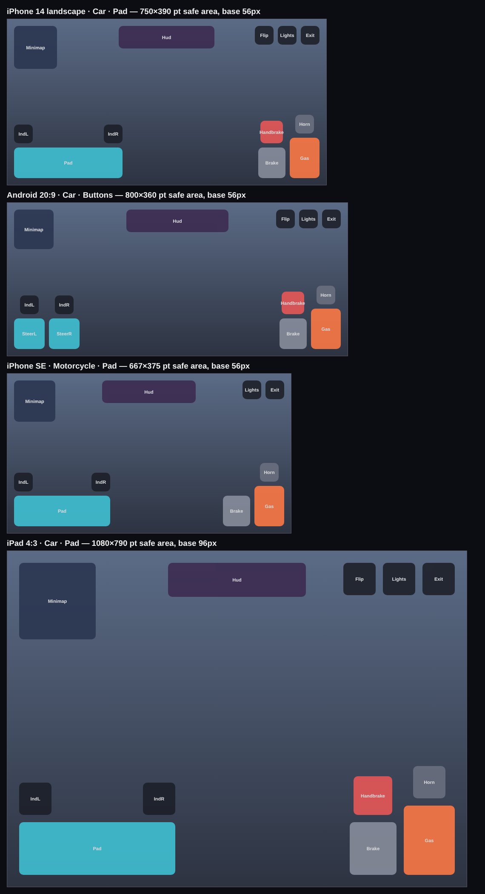

# SOLARA — Phase 3: Driving Camera, HUD and Mobile Controls

**Build:** `place/SOLARA_Phase3_DrivingUI.rbxlx` (original + Phase 1 menu + Phase 2 car physics + Phase 3).
**Status: implemented — NOT complete.** You asked for desktop and mobile testing before this is marked complete, and that requires Roblox Studio, which isn't available here.

What *was* verified:
- **Lint:** Luau linter, 0 errors in the new code.
- **Place build:** the build re-extracts and compares every script.
- **Mobile layout math:** the real `DrivingLayout.lua` was run in a Lua interpreter over **184 combinations**: 10 screen sizes × 3 button scales × car/motorcycle/passenger × pad/buttons, plus 4 desktop sizes. Result: **0 overlaps, 0 off-screen, every touch target ≥ 44 px** (`tools/test_driving_layout.py`).

What was *not* verified: how it looks and feels on a device, Roblox font rendering, camera feel. Those are the Studio steps in §5.

*Diagram of the rectangles the real layout module produces. This is not a game screenshot.*

## 1. Camera (still one controller)

`CameraController` remains the **only** writer of `Camera.CFrame`. VehicleController just requests the Vehicle/Motorcycle mode and passes the subject plus vehicle framing; nothing else touches the camera.

| Problem (audit H4) | Change | Value(s) |
|---|---|---|
| Pivot fell further behind with speed (≈12 studs at top speed) | Horizontal **velocity feed-forward**: steady-state lag ≈ 0 | `FollowSharpness` 14 car / 16 bike |
| Bumps shook the camera | Vertical follow is a separate, softer filter | `VerticalSharpness` 6 / 8 |
| One distance for every car; camera inside/below tall vans | **Framing from the vehicle's bounding box**: height ≥ roof + clearance, distance ≥ length × factor + pad, closest zoom ≥ half-length + 3 (can't enter its own vehicle) | `RoofClearance` 1.4 / 0.8, `LengthFactor` 0.7 / 0.8, `DistancePad` 3 / 2.5 |
| No sense of speed | FOV and distance grow with speed, capped; off with *Reduce motion* | `SpeedFovBoost` +9° / +10°, `SpeedDistanceBoost` +3 / +2.5 studs |
| Flat pitch on ramps | Auto-pitch follows part of the vehicle's slope | `AutoPitch` −11° / −10°, `PitchFollow` 0.5 / 0.6 |
| Auto-centre too slow at speed | Auto-follow tightens with speed (×0.7 → ×1.5) | `AutoFollowSharpness` 2.4 / 3 |
| Bike camera ignored lean | Camera rolls with 30% of the bike's lean (cars 0) | `RollFollow` 0 / 0.3 |
| Hard cuts entering/exiting, changing mode, resuming from menu | **One blend system**: from the current frame to the new target over 0.45 s (×0.35 with *Reduce motion*). A caller that needs a hard cut (respawn, behind the menu veil) cancels it with `SnapBehindCharacter()`. | `TRANSITION_TIME` 0.45 s |
| Zoom per mode ignored vehicle size | Vehicle zoom is stored as a ratio of each vehicle's framed distance | — |

Camera collision is unchanged and still applies: sphere-casts from pivot → shoulder → camera, excluding your own vehicle and characters.

## 2. HUD (`VehicleHUDController`)

- **Desktop/gamepad, bottom-right cluster:**
  - 270° RPM tick arc: white → orange above 75% → red above 90%.
  - Large speed (km/sa or km/h, following the player's language) with the gear in a ring; **R** shows in orange.
- **Status strip next to the cluster:** turn signals ◀ ▶ (drawn arrows, blinking green), headlights, handbrake **P**, plus **ABS / TCS / ESC**, which light while the Phase 2 assists actually intervene.
- **Vehicle status line:** the vehicle name with **Sürücü/Yolcu** (driver/passenger).
- **Minimap slot:** bottom-left circle named `MinimapSlot` (attribute `ReservedFor = "Minimap"`) with an "N" mark and "HARİTA · YAKINDA". The future minimap moves into it.
- **Touch:** a compact top-centre bar (speed, gear, two rows of status lights, segmented RPM) plus the minimap slot top-left. Both rectangles come from `DrivingLayout`, the same source the mobile buttons use.
- Updates at 20 Hz; no per-frame tables; no image assets.

## 3. Mobile controls (`MobileControlsController`)

- **Analog steering pad** (default): finger position = steering angle, with a 6% deadzone and a gentle curve (1.25) for fine corrections. It returns to centre when released, works with multi-touch, and keeps tracking if the finger slides off. It feeds a new analog channel, `InputController:SetAnalog("VehSteer")`, that cars and bikes both read.
- **Settings → Controls → Mobile steering:** *Slide pad* or *Buttons* (◀ ▶, digital, like before). *Mobile button size* still applies.
- **Placement** (from `DrivingLayout`):
  - large **GAS** at the right thumb, **BRAKE** to its left, **HANDBRAKE** above brake, **HORN** above gas
  - **EXIT · LIGHT · FLIP** top-right
  - turn signals above the steering control
  - minimap and HUD areas reserved at the top
  - on narrow or portrait screens the layout re-flows: HUD beside or below the map, steering buttons shrink, the top row moves below the HUD
- **Roblox's own joystick and jump button are hidden while driving** (`GuiService.TouchControlsEnabled`). The jump button used to sit under the gas pedal and could unseat the driver (audit H5).
- The on-foot sprint/camera buttons and the `SetLayout` API are unchanged. The ScreenGui now uses `CoreUISafeInsets` so nothing sits under the Roblox top bar.
- In Studio, the controller warns in Output if any layout overlap is ever detected at runtime.

**Keyboard/gamepad:** unchanged bindings. The gamepad stick and keyboard paths still work. Touch steering is only used while the pad is being touched.

## 4. Files

| Explorer path | Change |
|---|---|
| `StarterPlayer/StarterPlayerScripts/Controllers/CameraController` | Framing, velocity-compensated follow, vertical filter, pitch/roll follow, speed FOV/distance, blend transitions; `SetFollowSubject(part, framing?, smooth?)`, `SnapBehindCharacter(smooth?)` (both backward compatible) |
| `ReplicatedStorage/Modules/CameraConfig` | New Vehicle / Motorcycle profiles with every field documented |
| `ReplicatedStorage/Shared/Types` | Optional driving-camera fields on `CameraProfile` |
| `StarterPlayer/StarterPlayerScripts/Controllers/VehicleHUDController` | Rewritten (desktop cluster + touch bar + minimap slot) |
| `StarterPlayer/StarterPlayerScripts/Controllers/MobileControlsController` | Rewritten vehicle layout (pad, pedals, re-flow), touch-controls hiding, localized labels; on-foot behaviour kept |
| `StarterPlayer/StarterPlayerScripts/Controllers/InputController` | Analog channels `SetAnalog/GetAnalog`, cleared on vehicle exit and focus loss |
| `StarterPlayer/StarterPlayerScripts/Controllers/VehicleController` | Passes vehicle framing; smooth camera enter/exit; reads touch steering (cars and bikes) |
| `StarterPlayer/StarterPlayerScripts/Controllers/FrontEndController` | Resuming from the pause menu blends the camera instead of snapping |
| `StarterPlayer/StarterPlayerScripts/Vehicles/CarPhysics` | ABS/TCS/ESC activity flags for the HUD (telemetry only; physics unchanged) |
| `ReplicatedStorage/Shared/SettingsSchema`, `…/FrontEnd/Strings` | `MobileSteering` setting; HUD/mobile labels (TR/EN) |
| **New** `ReplicatedStorage/Modules/DrivingLayout` | Shared pure layout math (touch + desktop) |
| **New (repo)** `tools/test_driving_layout.py`, `tools/layout_preview.py`, `docs/phase3_touch_layout.png` | Layout test and diagram |

## 5. Studio test procedure (required before marking complete)

**Desktop**
1. Play → OYNA → walk to a car → **F**. The camera should *glide* (≈0.45 s) from behind you to behind the car. No jump cut, no fighting.
2. Drive straight to top speed. The car stays at roughly the same place on screen (no rubber-banding). FOV and distance open slightly at speed.
3. Drive over speed bumps or the test-course rough road (Phase 2 course): the camera stays steady vertically.
4. Get into the **Porter van** and the **Mesa pickup**, scroll the zoom fully in: the camera never enters the vehicle, and the road ahead stays visible over the roof.
5. Drive into a narrow street or next to a wall: the camera collides and pulls in without clipping through.
6. Press **F** while moving: the camera glides back behind the character.
7. Ride a motorcycle: closer framing, the camera tilts slightly with the lean.
8. HUD: speed matches the telemetry panel (F4). Gear shows R when reversing. **L** lights FAR, **Q/E** blink the arrows, holding **Space** lights **P**. ABS lights during hard braking, TCS during wheelspin (Mesa), ESC when the car begins to slide. The minimap slot is bottom-left, and nothing overlaps the Roblox top bar or chat.
9. Press **P** on foot → menu → **P** again: the camera glides back (no snap).
10. Gamepad: R2/L2 are analog, the stick steers, all D-pad and face buttons still work.

**Mobile** (Studio *Test → Device* emulator: iPhone SE, iPhone 14 Pro landscape, a 20:9 Android, iPad; then a real phone if you can)
1. Enter a car. Roblox's joystick and jump button disappear. The layout matches the diagram, with no overlaps and nothing under the top bar or notch.
2. Steering pad: drag gently for a slight curve, fully for full lock. Release returns to centre. Hold gas with the right thumb while steering with the left (multi-touch).
3. Settings → Controls → *Mobil direksiyon: Butonlar*: the arrow buttons appear instead of the pad. *Mobil buton boyutu: Büyük/Küçük* re-lays everything out without overlap.
4. Exit the car: the joystick and jump button return, and sprint/camera buttons work.
5. Rotate or resize (iPad split view) while driving: the layout re-flows.

When you report back, include any `Sürüş düzeni çakışması` warnings from Output (there should be none) and screenshots of the HUD on desktop and phone.

## 6. Not in this phase
- A cockpit/hood camera like the reference: the cars have no interior model yet.
- The minimap itself: only its slot exists.
- Pressure-sensitive mobile throttle: gas/brake are on/off, smoothed by the Phase 2 throttle ramp.
